<div align="center">


### Good services. Closer to home.

**A managed local-services marketplace for Hyderabad.** Customers discover trusted independent providers (home bakers, home kitchens, tutors, beauticians, repair technicians, travel planners) and send one enquiry. Tarkaash coordinates it with the provider and tracks it from request to payment.

[**Live demo**](https://tarkaash.vercel.app) · [Architecture](docs/ARCHITECTURE.md) · [Security](SECURITY.md) · [Deployment runbook](DEPLOYMENT.md) · [Database](supabase/README.md)

[](https://github.com/Rrachet/Tarkaash/actions/workflows/ci.yml)


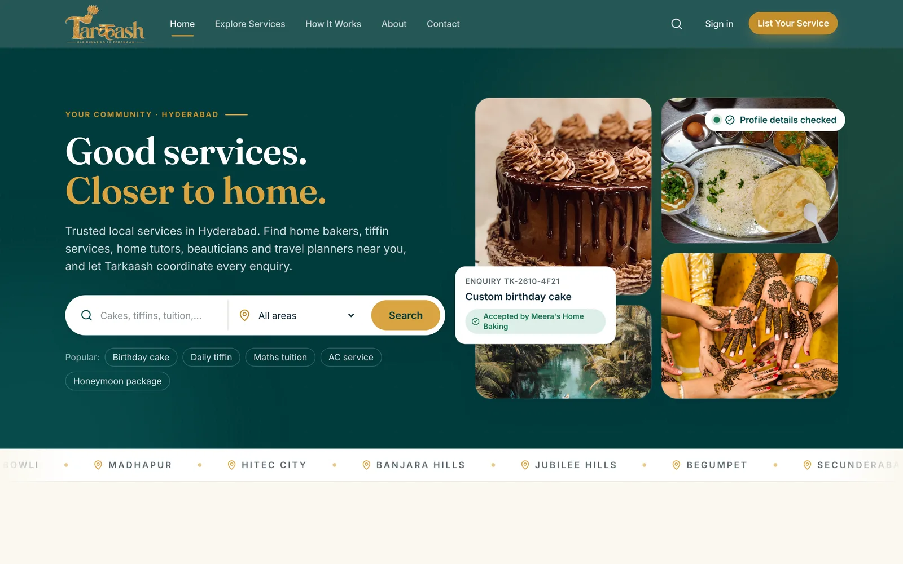

</div>

---

## Contents

- [Why Tarkaash](#why-tarkaash)
- [Product tour](#product-tour)
- [Features](#features)
- [Architecture](#architecture)
- [Tech stack](#tech-stack)
- [Security](#security)
- [Quality and testing](#quality-and-testing)
- [Getting started](#getting-started)
- [Project structure](#project-structure)
- [Deployment](#deployment)
- [Roadmap](#roadmap)
- [License](#license)

## Why Tarkaash

Finding a reliable home baker, tiffin service or tutor in an Indian city usually means WhatsApp forwards and unanswered calls. Independent providers, many of them women running businesses from home, have skills but little visibility and no tools.

Tarkaash sits in the middle as a **managed marketplace**:

| For customers | For providers | For the Tarkaash team |
| --- | --- | --- |
| Browse checked local providers by need and neighbourhood | A professional profile with services, prices and photos | One queue for every enquiry, with assignment and follow-up |
| One enquiry, a reference ID, and someone who follows up | Coordinated enquiries instead of cold calls | Full order lifecycle, payments and commission ledger |
| Contact details shared only with the provider who accepts | A dashboard of views, enquiries, conversion and earnings | Analytics, a boost queue for struggling vendors, platform P&L |

*Har Hunar Ko Ek Pehchaan*: every skill deserves recognition.

## Product tour

<table>
  <tr>
    <td width="50%">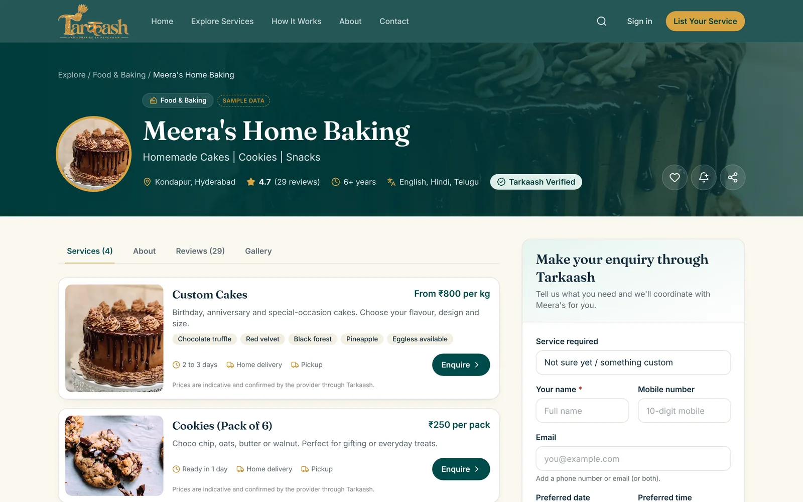<br/><sub><b>Vendor profile.</b> Services, reviews, gallery and a guided enquiry form that pre-fills from the chosen service.</sub></td>
    <td width="50%">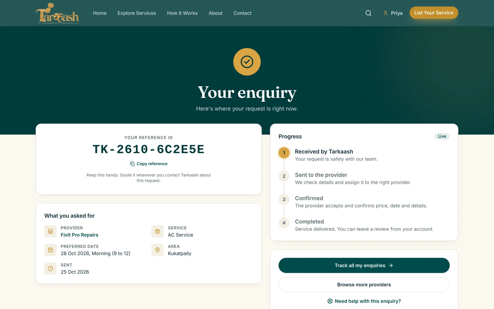<br/><sub><b>Enquiry tracking.</b> Reference ID, request summary and live progress, private to the customer.</sub></td>
  </tr>
  <tr>
    <td>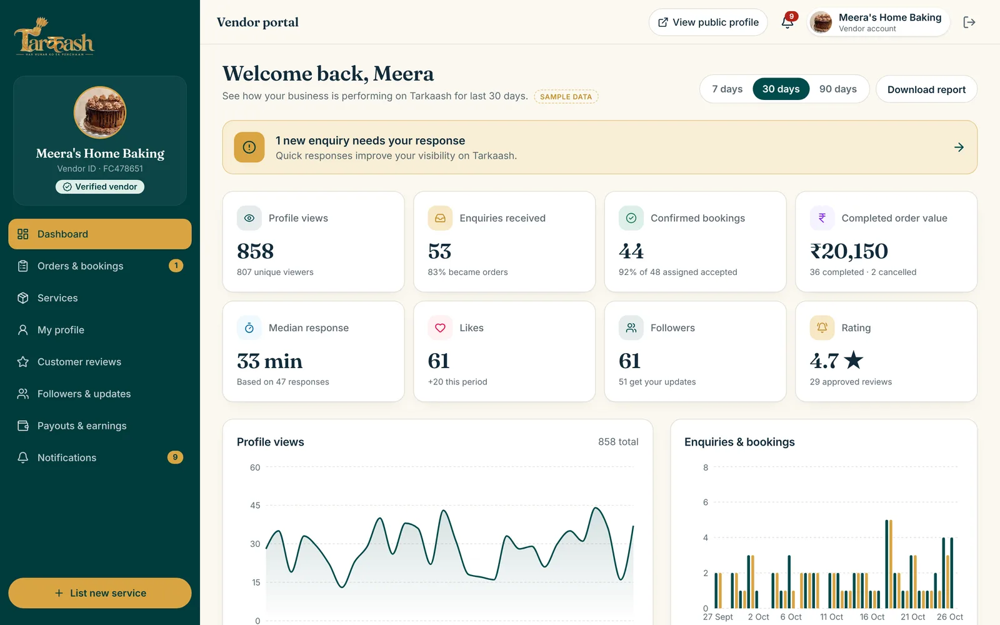<br/><sub><b>Vendor portal.</b> Views, enquiries, conversion, response time, earnings and followers.</sub></td>
    <td>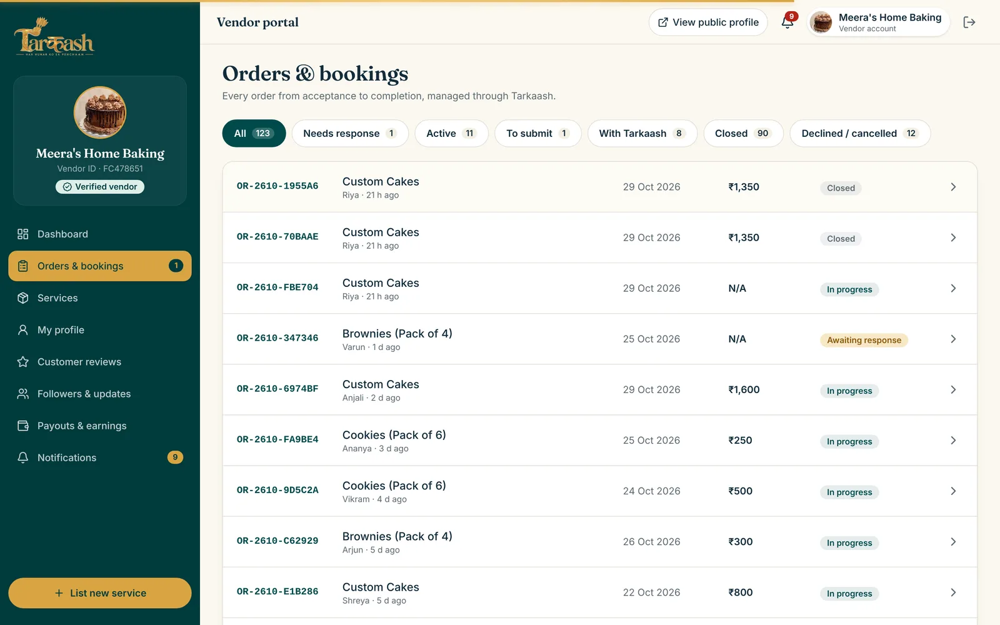<br/><sub><b>Order lifecycle.</b> Accept, deliver, record payment and submit to Tarkaash, every step audited.</sub></td>
  </tr>
  <tr>
    <td>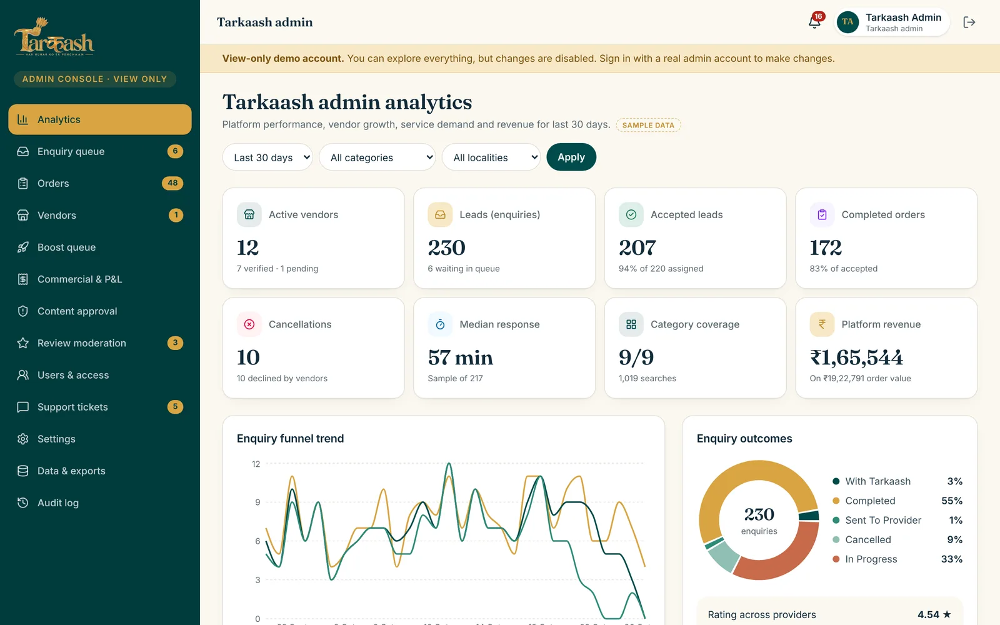<br/><sub><b>Admin analytics.</b> Funnel, outcomes, category demand, top vendors and revenue with CSV export.</sub></td>
    <td>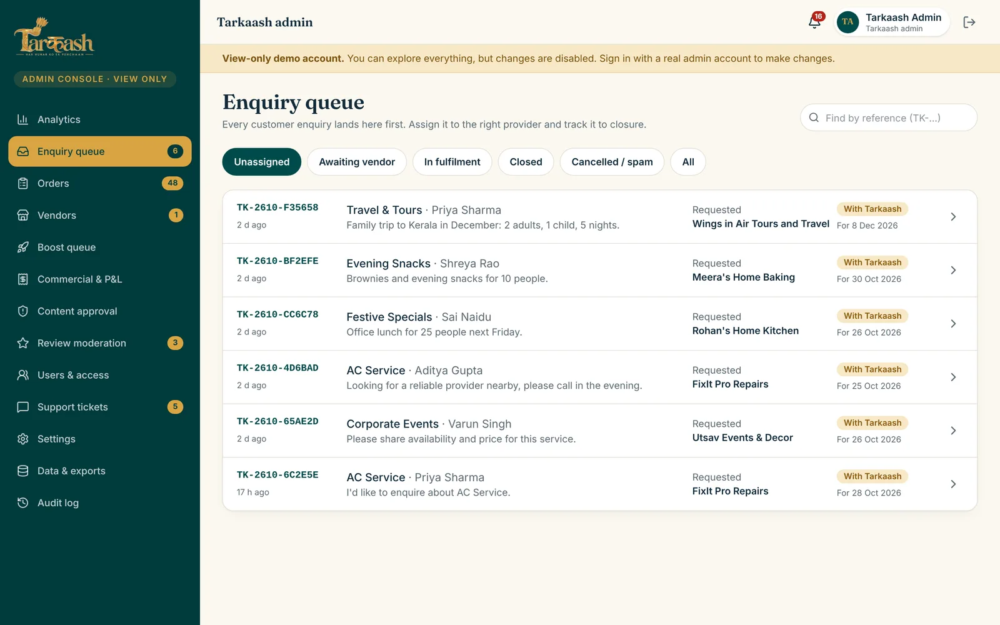<br/><sub><b>Enquiry queue.</b> Triage, assign to a provider, reassign on decline.</sub></td>
  </tr>
  <tr>
    <td>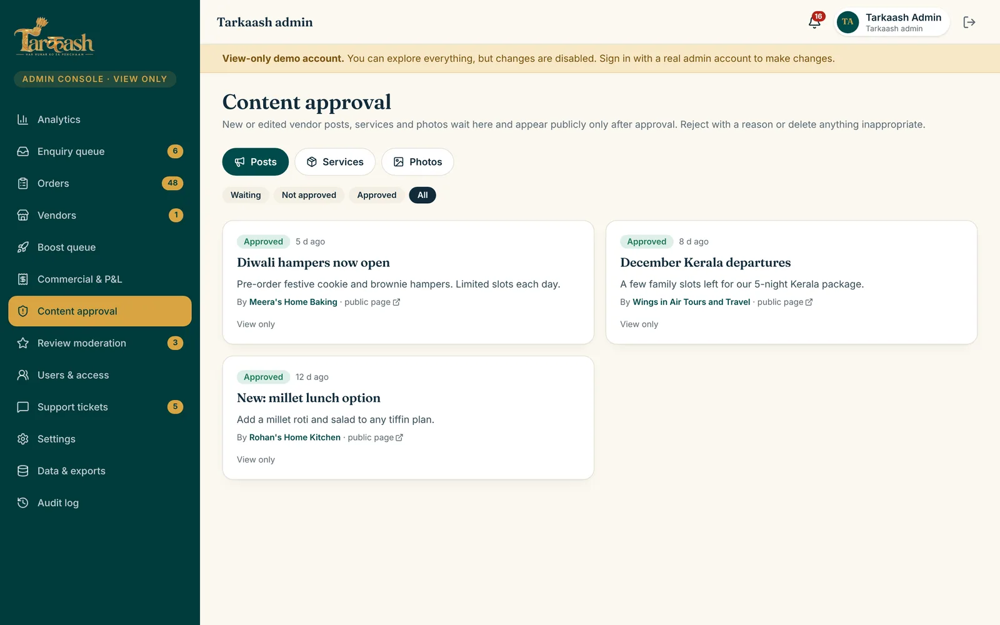<br/><sub><b>Content approval.</b> Vendor posts, services and photos go live only after approval.</sub></td>
    <td>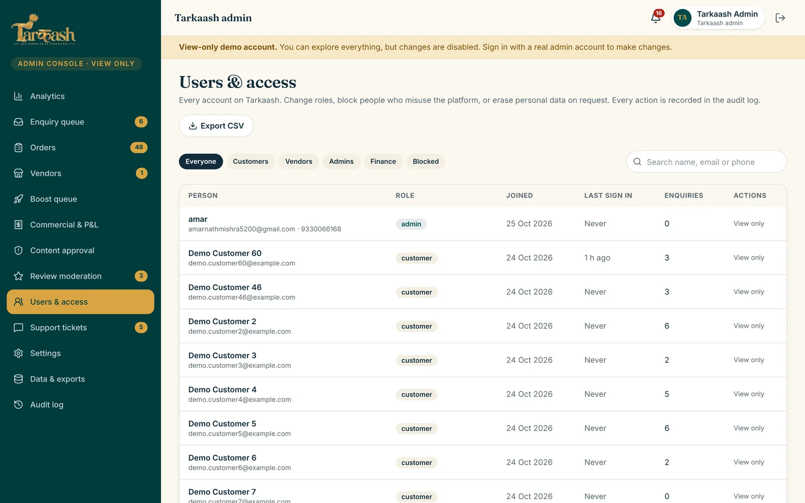<br/><sub><b>Users and access.</b> Roles, blocking and data erasure, all recorded in an append-only audit log.</sub></td>
  </tr>
  <tr>
    <td>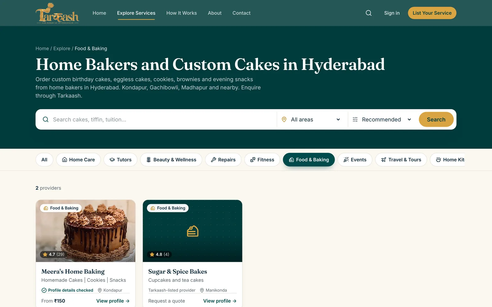<br/><sub><b>Local SEO landing pages.</b> One page per category and per Hyderabad neighbourhood.</sub></td>
    <td>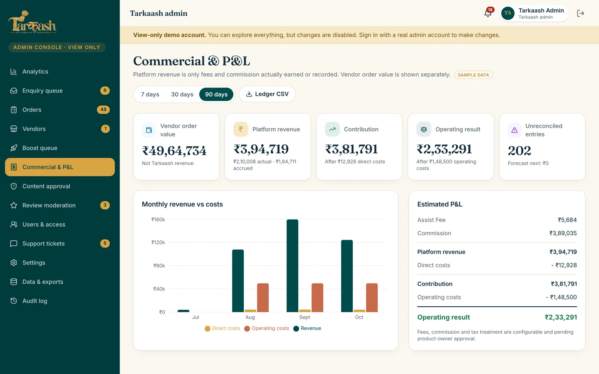<br/><sub><b>Commercial and P&L.</b> Commission and fees earned, direct and operating costs, contribution.</sub></td>
  </tr>
</table>

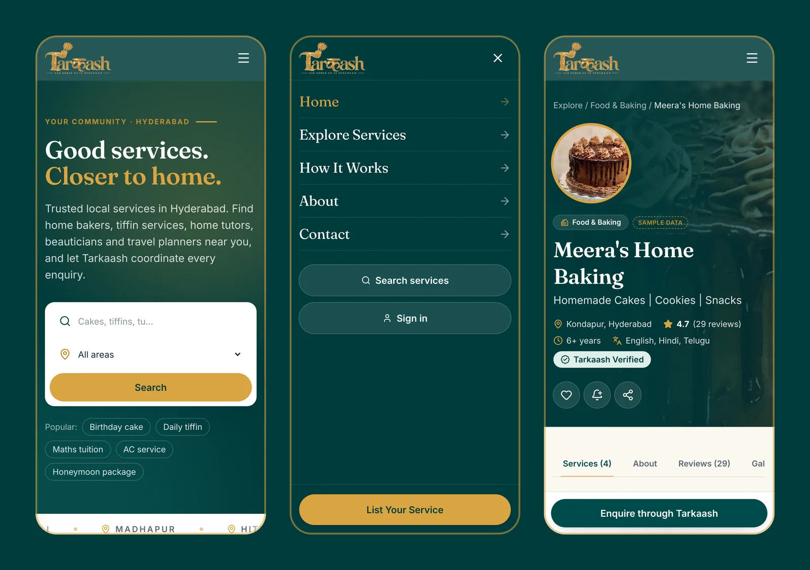

## Features

### Customers
- Search by keyword, category and neighbourhood; filter and sort providers
- Rich vendor profiles: services with indicative prices, lead times and delivery options, reviews, gallery, updates
- Guided enquiries with category-specific fields (cake size, tiffin plan, trip details), consent and an optional paid **Tarkaash Assist**
- Instant reference ID, a private confirmation page with live progress, and an account area for every enquiry and order
- Verified reviews only from customers with completed orders; like and follow providers

### Providers (vendor portal)
- Dashboard: profile views, enquiries, acceptance rate, median response time, completed value, followers, rating
- Orders: accept or decline, agree price and schedule, deliver, record payment, submit to Tarkaash; customer contact revealed only after acceptance
- Manage services, photos (Supabase Storage), profile and posts to followers, with approval status shown on each item
- Payouts and earnings, reviews and notifications

### Tarkaash team (admin console)
- **Enquiry queue** with assignment, notes, reassignment on decline and a full event timeline
- **Orders** across all vendors, closing an order books commission and fees into a ledger exactly once
- **Vendors**: onboarding approval, a verification checklist that controls the badge, listing edits, suspend, reactivate or remove (open orders are cancelled and re-queued)
- **Content approval** for vendor services, posts and photos, with reasons sent to the vendor
- **Users and access**: roles, view-only staff, blocking, personal data erasure
- **Analytics**: funnel, outcomes, category and locality demand, top vendors; date, category and locality filters
- **Boost queue**: explainable flags for vendors with low exposure, poor conversion, slow responses or weak listings
- **Commercial**: revenue by type, direct and operating costs, contribution and estimated P&L, with actual, accrued and forecast labels
- **Data and exports**: counts and CSV downloads for every kind of stored data; reviews moderation, support tickets, settings, notifications and an append-only **audit log**

### Platform
- Polished, accessible UI: design tokens, keyboard focus states, 44px touch targets, reduced-motion support, page transitions and scroll reveals
- Responsive from 360px phones to large desktops, with a full-screen mobile menu
- SEO, AEO and GEO for Hyderabad: category and neighbourhood landing pages, JSON-LD (Organization, LocalBusiness, FAQPage, BreadcrumbList, ItemList), sitemap, robots, `llms.txt` and a branded Open Graph image; indexing held behind a single switch until launch

## Architecture

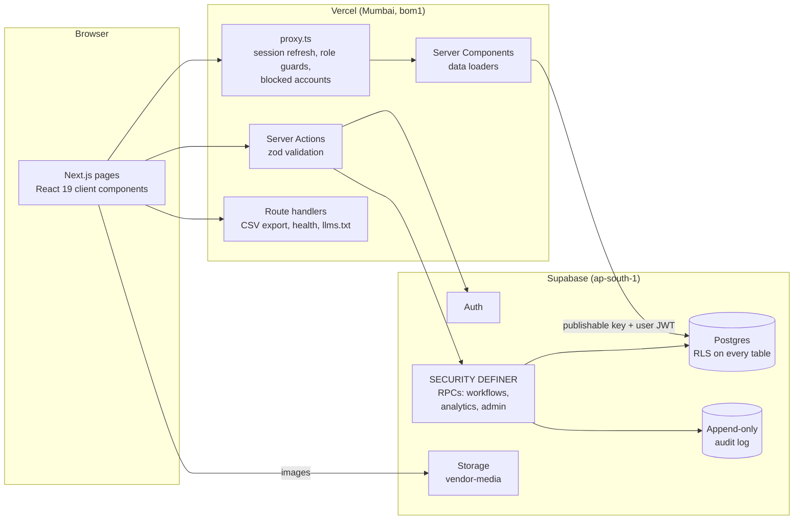

- **No service-role key in the app.** The web tier uses only the publishable key plus the signed-in user's session. Every read is filtered by row level security; every privileged write is a database function that checks the caller's role, validates input, rate-limits where needed and writes the audit log.
- **Business rules live in Postgres.** The order state machine is a transitions table enforced by `transition_order`; closing an order books the ledger exactly once; analytics (vendor metrics, admin metrics, boost rules, P&L) are SQL functions, so the numbers on every dashboard reconcile with the records.

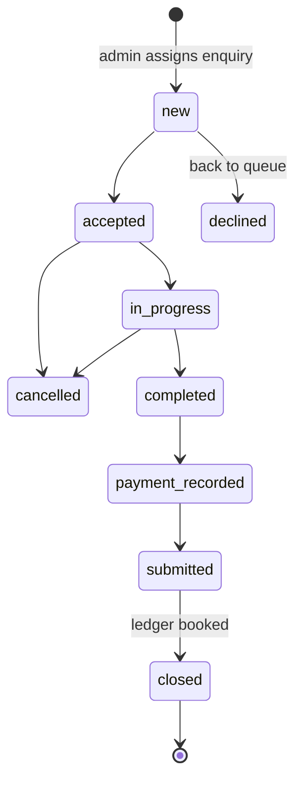

More detail, including the data model, in [docs/ARCHITECTURE.md](docs/ARCHITECTURE.md).

## Tech stack

| Layer | Choice |
| --- | --- |
| Framework | Next.js 16 (App Router, Server Components, Server Actions, `proxy.ts`), React 19, TypeScript (strict) |
| Styling | Tailwind CSS v4 with design tokens, Fraunces and Inter via `next/font`, lucide icons |
| Charts | Recharts |
| Validation | zod 4, mirrored by checks inside the database functions |
| Backend | Supabase: Postgres 17 with RLS, Auth (password and email code), Storage |
| Hosting | Vercel (functions in Mumbai, next to the database), automatic deploys from GitHub |
| Testing | Vitest (unit), SQL acceptance test, Node smoke test, Playwright end-to-end |
| CI | GitHub Actions: dependency audit, lint, typecheck, tests, production build |

## Security

Security is designed in, not bolted on. Highlights:

- Row level security on every table; vendors never see another vendor's data or the customer list
- Customer contact is released per order only after the vendor accepts, and every view is audited
- Privileged actions only through role-checked, validated, audited database functions; the audit log cannot be edited
- View-only staff accounts, account blocking that ends sessions, and personal data erasure for deletion requests
- Vendor content pre-moderation; removed or paused vendors disappear from every public surface
- Rate limits on enquiries, support tickets, vendor applications and analytics events; idempotent enquiry submission
- Content-Security-Policy, HSTS with preload, X-Frame-Options DENY, COOP, strict referrer and permissions policies
- Secrets stay on the server; CI fails on high or critical dependency advisories

See [SECURITY.md](SECURITY.md) for the full model and how to report a vulnerability.

## Quality and testing

| Check | What it covers | Command |
| --- | --- | --- |
| Lint and types | ESLint (Next.js rules) and strict TypeScript | `npm run lint && npm run typecheck` |
| Unit tests | Validation schemas, error mapping, CSV export, copy style | `npm test` |
| SQL acceptance test | 33 checks signed in as every role: full order lifecycle, cross-vendor isolation, ledger, metrics reconciliation, boost rules (always rolls back) | `supabase/tests/backend_test.sql` |
| Smoke test | Live access rules and exports for each demo role | `npm run smoke` |
| End-to-end | Playwright: guest enquiry, admin assignment, vendor works the order to closed, dashboards update | `node scripts/e2e.mjs` |

## Getting started

**Prerequisites:** Node.js 22 and a Supabase project.

```bash
git clone https://github.com/Rrachet/Tarkaash.git
cd Tarkaash
npm install
cp .env.example .env.local   # then fill in the values below
npm run dev                  # http://localhost:3000
```

| Variable | Purpose |
| --- | --- |
| `NEXT_PUBLIC_SUPABASE_URL` | Your Supabase project URL |
| `NEXT_PUBLIC_SUPABASE_PUBLISHABLE_KEY` | Supabase publishable key (safe for the browser; RLS protects data) |
| `NEXT_PUBLIC_SITE_URL` | Public origin, used for canonical URLs, sitemap and auth redirects |
| `NEXT_PUBLIC_DEMO_MODE` | `1` shows one-click demo accounts on the sign-in page |
| `DEMO_PASSWORD` | Server-only password for those demo accounts (never sent to the browser) |
| `NEXT_PUBLIC_ALLOW_INDEXING` | `1` lets search engines index the site (keep `0` while demo data is live) |
| `NEXT_PUBLIC_GOOGLE_SITE_VERIFICATION` | Optional Search Console verification code |

**Database:** apply the migrations in `supabase/migrations` in order, then optionally load the demo seed. Roles, the order lifecycle and the demo accounts are documented in [supabase/README.md](supabase/README.md).

**Try it without installing:** open the [live demo](https://tarkaash.vercel.app/login) and use the one-click demo accounts (admin and finance are view only).

## Project structure

```
app/
  (site)/            public site: home, explore, category and area pages, vendor profiles,
                     enquiry confirmation, account, about, contact, legal
  (auth)/            sign in, sign up, password reset
  vendor/            vendor portal
  admin/             admin console
  api/               CSV exports, health check
  robots.ts, sitemap.ts, llms.txt/, opengraph-image.tsx
components/          UI primitives, layout, marketing, portal, admin, motion, SEO
lib/
  actions/           server actions (public, auth, customer, vendor, admin)
  data/              server-side data loaders
  content/           copy, keyword map, image map
  supabase/          browser, server and proxy clients
  types/database.ts  generated database types
supabase/
  migrations/        schema, RLS, workflows, analytics, storage, hardening
  seed/              demo data
  tests/             SQL acceptance test
scripts/             smoke and end-to-end tests
docs/                architecture notes and screenshots
```

## Deployment

The app deploys to Vercel on every push; the database runs on Supabase in Mumbai. [DEPLOYMENT.md](DEPLOYMENT.md) covers environment variables, auth settings, custom domains, the security model, backups and the launch checklist (switching off demo data and turning on indexing).

## Roadmap

- Email and WhatsApp notifications for customers and vendors (Resend, WhatsApp Business API)
- Online payments and automated vendor payouts
- Customer-facing order chat coordinated by Tarkaash
- Expansion beyond Hyderabad with city-level landing pages
- Vendor subscription plans and promoted listings

## License

Copyright © 2026 Tarkaash. All rights reserved. The source is published for portfolio and review purposes only; see [LICENSE](LICENSE).

All providers, prices, reviews and metrics in the demo are illustrative sample data. Images are from Unsplash under the Unsplash License.
