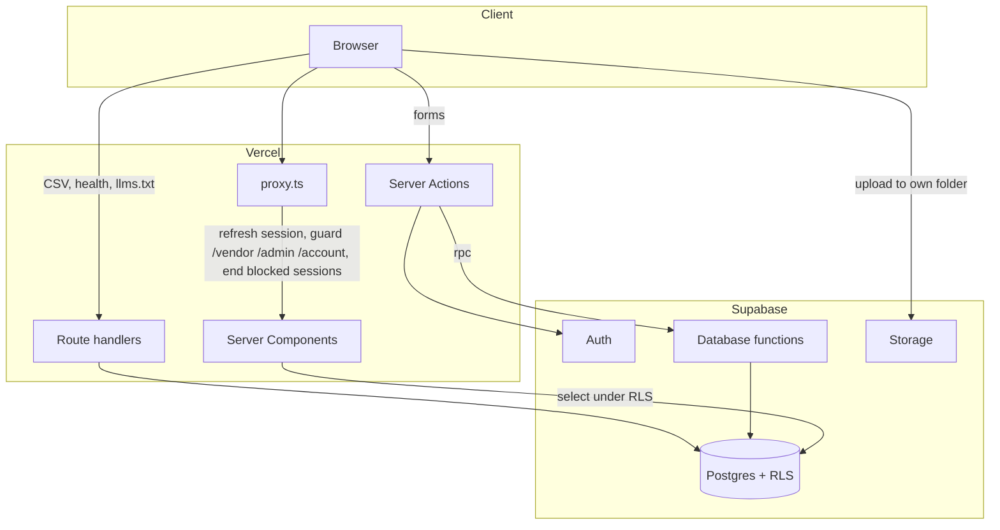
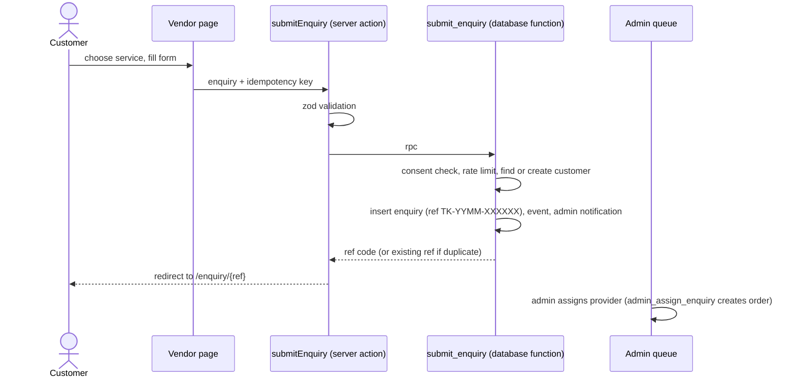
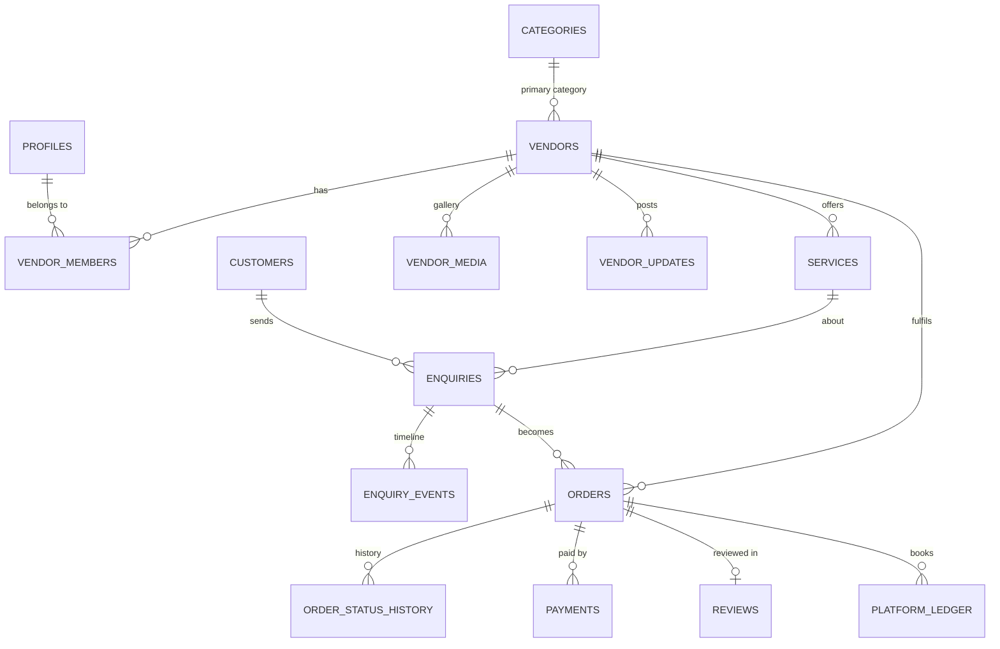

# Architecture

Tarkaash is a Next.js 16 application on Vercel backed by Supabase (Postgres, Auth, Storage). The defining design choice: **the database is the security and business-rules boundary**. The web tier holds no privileged credentials.

## System overview

| Layer | Responsibility |
| --- | --- |
| `proxy.ts` | Refreshes the Supabase session cookie, enforces route-level role guards, signs out blocked accounts, redirects legacy URLs |
| Server Components (`app/**/page.tsx`, `lib/data/*`) | Read data with the user's session; row level security decides what each role sees |
| Server Actions (`lib/actions/*`) | Validate input with zod, call database functions, map database errors to friendly messages, revalidate pages |
| Route handlers (`app/api/*`, `app/llms.txt`) | CSV exports (staff only), health check, AI-assistant summary |
| Database functions (`supabase/migrations/0003`, `0004`, `0012`) | Every privileged write: role check, validation, rate limit, state transition, audit entry |

## Request lifecycle: a customer enquiry

## Data model (core)

Supporting tables: `order_transitions` (allowed state changes), `analytics_events`, `cost_entries`, `support_tickets`, `notifications`, `follows`, `likes`, `settings` (configurable fees, thresholds, moderation), `audit_log` (append only) and `rate_limits`.

## Roles

| Role | Reads | Writes |
| --- | --- | --- |
| Visitor | Live vendors, approved services, posts, photos and reviews, public settings | `submit_enquiry`, `submit_ticket`, `log_event` |
| Customer | Own enquiries, orders and account | Likes, follows, reviews on own completed orders, vendor application |
| Vendor | Own listing, services, assigned orders, own analytics | Listing and content (moderated), order transitions, payments; customer contact after accepting |
| Admin | Everything | Assignment, approvals, verification, moderation, users, settings, vendor removal |
| Finance | Everything | Payment verification, ledger and costs |
| View-only staff | Everything an admin or finance user can read | Nothing (showcase demo accounts) |

## Order lifecycle

`new → accepted | declined → in_progress → completed → payment_recorded → submitted → closed`, plus `cancelled` from accepted or in progress. Allowed moves live in `order_transitions` and are enforced by `transition_order`. A decline returns the enquiry to the admin queue. Closing books commission and any Tarkaash Assist fee in `platform_ledger` exactly once.

## Analytics

Metrics are SQL functions over events and orders, so dashboards reconcile with the underlying records:

- `vendor_metrics`: views, unique viewers, enquiries, acceptance rate (with its denominator), median response time (with sample size), completion and cancellations, value, followers, rating, listing completeness
- `admin_metrics`: platform funnel, outcomes, category and locality demand, top vendors, revenue
- `boost_queue`: explainable flags (low exposure, poor conversion, slow response, high cancellations, low rating, weak listing) with the measured value and a suggested action
- `commercial_summary`: revenue by type, direct and operating costs, contribution, estimated P&L by month

## Frontend

- Design tokens in `app/globals.css` (Tailwind v4 `@theme`), Fraunces for display and Inter for text
- Motion system: page transitions, a Web Animations scroll-reveal observer that never touches React-managed DOM, pointer parallax, all disabled under `prefers-reduced-motion`
- SEO layer in `lib/seo.ts` and `lib/content/seo.ts`: per-page metadata, JSON-LD builders, keyword map, sitemap, robots and `llms.txt`
